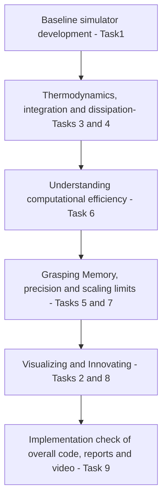

# Toy Model for exploring Molecular interactions:
## Objectives:
The project aims to develop a basic model of motion of particles in 2D container of fixed dimensions. It doesn't take into account full-scale Molecular
Dynamics but provides a simplistic idea of how modelling particles works.
## Project_Flowchart:
The project has been split into the following steps with each part allocated to a member of the team.

## Details of Members:
- Sridatt Sathyanarayanan - MS26BTECH11035
- Sreeshanth Reddy Tipeereddy - MS26BTECH11037
- Saswat - MS26BTECH11033
- Niranjan S M - MS26BTECH11025
- Ayaan - MS26BTECH11010
- Adhwin - MS26BTECH11001
## Sequence of Videos:
1. Video-1: Sridatt Sathyanarayanan
2. Video-2: Sreeshanth Reddy Tipeereddy, Ayaan
3. Video-3: Adhwin
4. Video-4: Niranjan
5. Video-5: Saswat
6. Video-6: Sreeshanth, Ayaan, Adhwin
## Roles and Responsibilities:
- Sridatt Sathyanarayanan-
     - Project lead
     - Developed the Baseline Simulator, checked its implementation and handled verification of the same
     - Contributed in providing the idea for the innovation and how to implement the same over the Baseline simulator, compiled the reports provided by the        team members.
- Sreeshanth Reddy Tipeereddy-
     - Drafted the animation of the toy model simulator
     - Handled the innovation and provided the report on innovation
- Adhwin-
     - Handled tasks 3 and 4, that is, energy conservation, timestep and dissipation.
     - Contributed to the innovation code.
- Saswat-
     - Wrote three versions of pair-force calculations and verified that all three give the same forces
     - Timed them at N = 50 to 1000 and found C fastest and Numpy about 3.4 to 4.2x faster than python .
- Ayaan-
     - Worked on the animation part of the project
     - Thought and implementation of innovation in the project
- Niranjan-
     - Worked on the code and implementation of tasks 5 and 7, that is numerical precision and memory cum scalability.
     - Analysed the difference in usage of float32 and float64 for the simulator.
## Acknowledgement of AI usage:
The following AI tools were used by the members as a means to aid in the code development and debugging process.It was used as a tool to learn new code and understand the simulation better.
- Gemini
- ChatGPT
- Claude
## Files Shared:
1. README
2. Video files
3. Source Codes, Testing Codes, Visualization codes
4. Word document and the PDF file containing results - time snapshots, relevant plots ( also contains algorithms, implementation details and results)
5. Prompts and recorded sessions with AI

